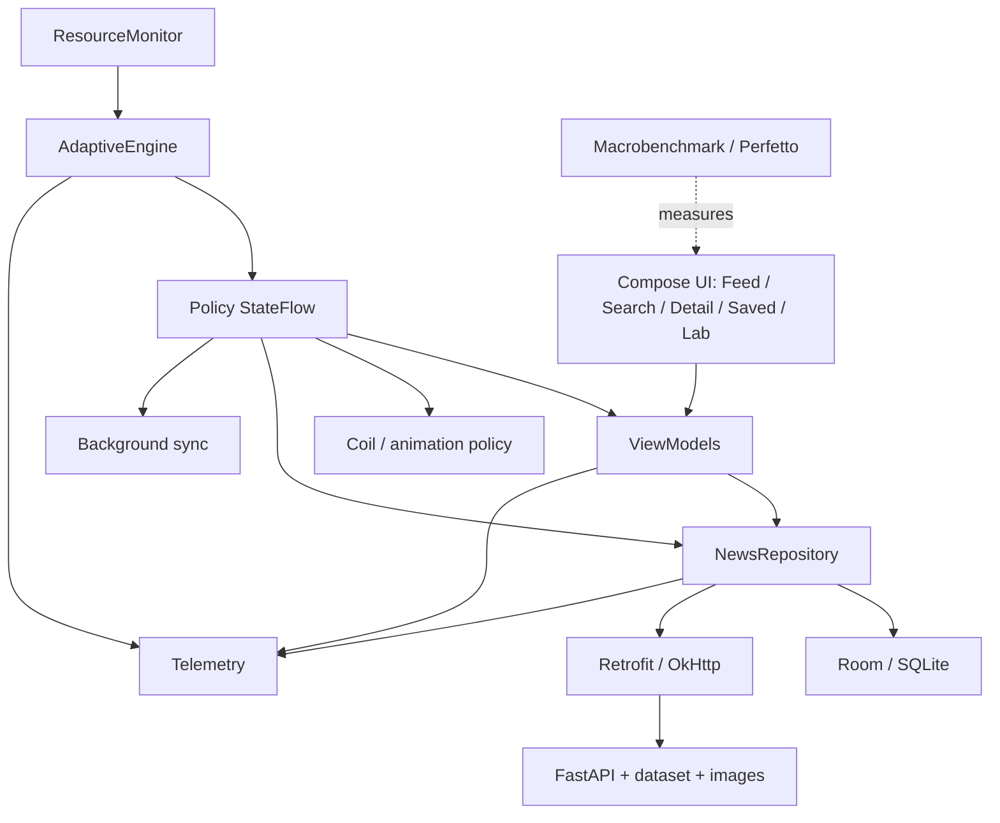

# ADAPTIVE NEWS — CORE SPECIFICATION

**Phiên bản:** 1.0 | **Nhóm:** Chiến, Hoàng, Hoàn, Tú  
**Tên chuyên đề:** Tối ưu hóa hiệu năng thích ứng đa tài nguyên trên ứng dụng di động dựa trên ngữ cảnh thiết bị (Context-Aware Adaptive Performance Optimization).

> Đây là đặc tả chung để cả nhóm triển khai song song. Các ngưỡng và cấu hình dưới đây là giả thuyết thiết kế ban đầu, không phải kết quả thực nghiệm. Mọi thay đổi hợp đồng chung phải được thống nhất và ghi vào CHANGELOG.md.

## 1. Mục tiêu và phạm vi

Xây dựng Adaptive News, ứng dụng Android đọc tin tức với 10.000 bài viết có ảnh, nhằm kiểm chứng liệu điều phối tài nguyên thích ứng có đem lại sự cân bằng tốt hơn cấu hình cố định trong các điều kiện thiết bị và mạng khác nhau.

**Câu hỏi nghiên cứu:** (RQ1) Tối ưu tĩnh cải thiện hiệu năng bao nhiêu so với baseline? (RQ2) Điều phối thích ứng có giảm RAM, lưu lượng thừa và độ giật trong điều kiện bất lợi so với tối ưu tĩnh không? (RQ3) Chi phí điều phối, chất lượng ảnh và độ trễ phát sinh là bao nhiêu?

### Phạm vi MVP bắt buộc
- Danh sách tin có thumbnail, cuộn và phân trang; tìm kiếm theo tiêu đề; xem chi tiết; lưu và đọc bài đã lưu ngoại tuyến.
- Màn hình Lab: chọn phiên bản V1/V2/V3, xem trạng thái thiết bị, cấu hình đang dùng, lý do chuyển chế độ; hỗ trợ tiêm trạng thái giả lập để kiểm thử quyết định.
- Backend trả cùng tập dữ liệu cho mọi phiên bản; có nhiều kích thước ảnh thực sự khác nhau.
- Ghi log theo schema chung, xuất kết quả đo thành CSV/JSON; có kịch bản đo lặp lại được.

Không triển khai đăng nhập, thanh toán, AI gợi ý tin, push notification hay hệ thống quản trị. Không cần GPU, root hoặc sửa hệ điều hành. Không xây ba ứng dụng riêng.

## 2. Phân công và quyền sở hữu

| Người | Vai trò | Phạm vi sở hữu | Sản phẩm bàn giao |
|---|---|---|---|
| Chiến | Nghiên cứu và báo cáo | docs/, tổng quan tài liệu, phương pháp, kiến trúc, phân tích kết quả, tổng hợp báo cáo | Báo cáo Word, bảng tài liệu tham khảo, hình kiến trúc, bảng/biểu đồ kết quả, thảo luận |
| Hoàng | Mobile UI và điều phối | app/ui/, app/adaptive/, app/platform/, app/telemetry/ | UI đủ chức năng, ResourceMonitor, AdaptiveEngine, Lab screen, kết nối chính sách với UI/Coil, bộ test engine |
| Hoàn | Data và backend | app/data/, backend/, dữ liệu mẫu | REST API, generator, Room/Paging, mạng/cache/prefetch, đồng bộ nền, kết nối chính sách với data layer |
| Tú | Đo đạc và kiểm thử | benchmark/, experiments/, scripts/ | Macrobenchmark, kịch bản tải, dữ liệu đo thô, script tổng hợp, báo cáo đo và hướng dẫn tái lập |

Hoàng và Hoàn cùng tích hợp ứng dụng; Chiến không chịu trách nhiệm code ứng dụng; Tú không phải xây tính năng sản phẩm. Tú báo lỗi và kiểm tra lại; chủ sở hữu module sửa lỗi. Chiến tổng hợp bằng chứng và kết quả, không tự điền số liệu giả.

## 3. Kiến trúc chung



**Luồng:** ResourceMonitor → snapshot → AdaptiveEngine → policy bất biến → UI và Data thực thi → Telemetry ghi kết quả. Engine không gọi trực tiếp HTTP, Room hoặc Compose. Policy là nguồn sự thật duy nhất; các module không tự đặt ngưỡng riêng.

### Stack và môi trường
Kotlin, Jetpack Compose, single Activity, ViewModel, Coroutines/Flow, Coil, Room, Paging 3, Retrofit/OkHttp, WorkManager; backend Python FastAPI + Uvicorn + Pillow; đo bằng AndroidX Macrobenchmark, Perfetto, adb và Android Studio Profiler. Khuyến nghị minSdk 26; chọn compile/target SDK ổn định có trên máy nhóm. Hoàng chốt phiên bản Gradle/JDK/dependencies trong version catalog và README ngay khi khởi tạo, không tự nâng giữa đợt đo. Package thống nhất `com.adaptivenews.app`.

## 4. Cấu trúc repository và quy tắc tích hợp

```text
adaptive-news/
  README.md
  CORE.md                       # bản đặc tả này
  CHANGELOG.md
  contracts/                    # schema JSON, API samples, policy fixtures
  android/
    app/src/main/java/com/adaptivenews/app/
      core/contract/            # kiểu dữ liệu và interface chung
      ui/                       # Hoàng
      adaptive/                 # Hoàng
      platform/                 # Hoàng
      telemetry/                # Hoàng
      data/                     # Hoàn
    app/src/main/assets/        # fixture nhỏ cho UI
    app/src/test/               # unit tests
    benchmark/                  # Tú
  backend/                      # Hoàn
  experiments/                  # Tú: protocol, raw, processed
  scripts/                      # Tú
  docs/                         # Chiến
```

Hoàng tạo skeleton Gradle, contract và app chạy được; Hoàn tạo backend độc lập; Tú có thể chuẩn bị script từ package/test tags/schema; Chiến viết báo cáo dựa trên đặc tả. Mỗi người dùng nhánh `feature/hoang-mobile`, `feature/hoan-data`, `feature/tu-benchmark`, `docs/chien-report`; merge PR nhỏ vào main. `core/contract/`, build config và schema là vùng dùng chung; sửa phải thông báo trước. Không commit APK lớn, build output, secrets hoặc toàn bộ dữ liệu ảnh sinh được; commit generator và seed.

## 5. Hợp đồng API và dữ liệu (Hoàn triển khai, Hoàng dùng mock ngay)

Base URL emulator: `http://10.0.2.2:8000/`; thiết bị thật dùng `adb reverse tcp:8000 tcp:8000` và `http://127.0.0.1:8000/`. HTTP cleartext chỉ cho môi trường demo nội bộ (debug/benchmark config); không dùng làm cấu hình production.

| Method/path | Request | Response |
|---|---|---|
| GET /health | — | {"status":"ok"} |
| GET /v1/articles | cursor (optional), limit (1..100), q (optional) | {"items":[ArticleSummary],"next_cursor":"..." hoặc null} |
| GET /v1/articles/{id} | id | ArticleDetail hoặc 404 |
| GET /v1/images/{id}?width=360 | width ∈ {360,720,1080} | image/webp hoặc JPEG theo fixture, Cache-Control và ETag |

Cursor opaque, thứ tự cố định `id ASC`; nếu q thay đổi phải reset cursor. Không dùng cursor của truy vấn khác. q tìm chuỗi tiêu đề không phân biệt hoa thường; trim khoảng trắng. Mọi phiên bản dùng cùng quy tắc tìm kiếm. API lỗi: `{"error":"invalid_request","message":"..."}`; timeout/retry có giới hạn. Ảnh thumbnail lấy URL tương đối để client ghép base URL. ETag phản ánh nội dung; 304 không có body. Server không tự thêm độ trễ trong lần đo mạng chính.

```json
{
  "items": [{"id": 1, "title": "Tin công nghệ 00001", "summary": "Nội dung tóm tắt", "category": "Technology", "published_at": "2026-01-01T00:00:00Z", "image_path": "/v1/images/1"}],
  "next_cursor": "opaque-cursor"
}
```

ArticleDetail có toàn bộ trường ArticleSummary và `body` (string). Không tải toàn bộ body trong feed. Dataset sinh bằng seed 42, 10.000 ID duy nhất, 5 nhóm chủ đề, nội dung cố định, 3 độ phân giải ảnh có cùng nội dung và tỉ lệ; tạo ảnh tổng hợp hoặc tài nguyên có giấy phép, không dùng API tin tức bên ngoài. Lưu manifest gồm seed, số record, hash dữ liệu, số byte ảnh theo size. V1 có thể lấy toàn bộ summary bằng cách lần lượt gọi API tối đa 100 record/lần; không thêm endpoint ưu ái phiên bản nào. Fixture UI 30 bài, có success/empty/error và ảnh placeholder; dùng cùng DTO như backend.

### Interface Kotlin dùng chung

```kotlin
// core/contract — các DTO có @Serializable hoặc adapter tương ứng ở data layer
// imports: kotlinx.coroutines.flow.Flow, kotlinx.coroutines.flow.StateFlow

enum class Variant { V1, V2, V3 }
enum class Mode { BASELINE, PERFORMANCE, BALANCED, ECO }
enum class MemoryPressure { NORMAL, MODERATE, CRITICAL, UNKNOWN }
enum class Thermal { NORMAL, MODERATE, SEVERE, UNKNOWN }
enum class LinkQuality { FAST, SLOW, UNKNOWN, OFFLINE }

data class ResourceSnapshot(
    val elapsedMs: Long, val memory: MemoryPressure,
    val batteryPct: Int?, val powerSave: Boolean?,
    val thermal: Thermal, val link: LinkQuality,
    val metered: Boolean?, val appCpuPct: Double? = null
)
data class Policy(
    val mode: Mode, val imageWidth: Int, val pageSize: Int,
    val memoryCacheBytes: Long, val prefetchCount: Int,
    val maxConcurrentRequests: Int, val animations: Boolean,
    val syncMinutes: Long, val allowNetwork: Boolean,
    val optimized: Boolean, val reason: String
)
data class ArticleSummary(
    val id: Long, val title: String, val summary: String,
    val category: String, val publishedAt: String, val imagePath: String
)
data class ArticleDetail(val article: ArticleSummary, val body: String)
data class ArticlePage(val items: List<ArticleSummary>, val nextCursor: String?)
interface ResourceMonitor { val snapshots: Flow<ResourceSnapshot> }
interface PolicyProvider { val policy: StateFlow<Policy> }
interface NewsRepository {
    suspend fun page(query: String, cursor: String?, limit: Int): ArticlePage
    suspend fun detail(id: Long): ArticleDetail
    fun saved(): Flow<List<ArticleDetail>>
    suspend fun setSaved(article: ArticleDetail, saved: Boolean)
}
```

Repository nhận PolicyProvider qua constructor; adapter PagingSource gọi `page()` cho V2/V3, V1 gọi tuần tự để nạp toàn bộ. UI nhận policy để dựng ảnh, giới hạn hiệu ứng. Wire DTO snake_case và domain model camelCase được mapper tách riêng. `FakeNewsRepository` và `FakeResourceMonitor` phải có từ đầu để UI/engine chạy không cần backend. Mỗi lần thay pageSize không tự hủy danh sách đang hiển thị: áp dụng cho lần refresh/query mới; cache và prefetch thay đổi theo vòng đời, không tạo ImageLoader mỗi lần policy đổi.

## 6. Ba phiên bản thực nghiệm

Cùng codebase, cùng thiết kế, chức năng, dữ liệu và kịch bản; ưu tiên runtime variant trên cùng build benchmark. Variant được chọn trước khi chạy, restart app và reset cache theo protocol. Không cố tình tạo vòng lặp vô ích hoặc làm chậm baseline. V1 phải là cách triển khai hợp lý nhưng chưa dùng nhóm kỹ thuật đang nghiên cứu.

| Tham số | V1 baseline | V2 tĩnh | V3 Performance | V3 Balanced | V3 Eco |
|---|---|---|---|---|---|
| Ảnh tải về (px) | 1080 | 720 | 1080 | 720 | 360 |
| Feed | eager summary | Paging 3 | Paging 3 | Paging 3 | Paging 3 |
| Page size | 100/API, nạp hết | 20 | 40 | 20 | 10 |
| Image memory cache budget | mặc định thư viện, ghi nhận | 32 MiB | 64 MiB | 32 MiB | 16 MiB |
| Prefetch chủ động | 0 | 4 | 10 | 4 | 0 |
| Concurrent image/data requests (tổng mục tiêu) | mặc định, ghi nhận | 4 | 6 | 4 | 2 |
| Hiệu ứng phụ | bật | giới hạn | bật | giới hạn | tắt |
| Đồng bộ nền định kỳ | 15 phút | 30 phút | 15 phút | 30 phút | 60 phút |
| Điều phối thích ứng | không | không | có | có | có |

V1 vẫn dùng LazyColumn để không tạo baseline phi thực tế; khác biệt UI nằm ở cách cấp dữ liệu, cấu hình ảnh, ổn định item và tối ưu recompose. V1 có lưu bài offline như các phiên bản khác; không vô hiệu hóa chức năng để lấy kết quả. V2 và V3 dùng cùng cơ chế tối ưu, khác cấu hình và engine. R8/Baseline Profiles nếu đo riêng thì dùng build flavor/benchmark riêng; không trộn vào kết luận về engine. Cache budget là giới hạn mục tiêu, không phải cam kết heap thực. Nếu Coil phiên bản được chọn không hỗ trợ resize cache runtime, dùng cache wrapper hoặc áp dụng budget khi khởi tạo lại ở điểm an toàn; ghi rõ overhead và không tạo lại loader liên tục.

## 7. Bộ điều phối thích ứng (Hoàng)

### 7.1 Thu thập tín hiệu

| Tín hiệu | Nguồn | Cách diễn giải |
|---|---|---|
| RAM | ActivityManager.MemoryInfo + heap app, onTrimMemory khi khả dụng | Critical khi lowMemory hoặc heap ≥85%; Moderate khi heap ≥70%; còn lại Normal; đây là heuristic, không đại diện toàn bộ RSS |
| Pin | BatteryManager / ACTION_BATTERY_CHANGED | % pin nullable nếu không đọc được |
| Power saver | PowerManager.isPowerSaveMode | ưu tiên tiết kiệm |
| Nhiệt | PowerManager thermal status API 29+ | Moderate/Severe theo trạng thái thermal; API thấp hơn UNKNOWN |
| Mạng | ConnectivityManager, NetworkCapabilities; EWMA thời gian request thành công | Offline nếu không có kết nối; Slow nếu EWMA >800 ms, Fast nếu ≤400 ms; vùng giữa giữ trạng thái cũ; chưa đủ mẫu = Unknown |
| CPU app | Process.getElapsedCpuTime chênh lệch theo thời gian | chỉ telemetry ở MVP, không dùng làm ngưỡng quyết định; ghi rõ cách chuẩn hóa |

Không gửi ping thăm dò liên tục. EWMA dùng request bài viết thành công, alpha=0.3, tối thiểu 3 mẫu; không lấy latency decode ảnh làm chất lượng mạng. Snapshot định kỳ 5 giây khi foreground, kết hợp callback có sẵn; pause khi background nếu không cần. Dùng monotonic elapsedRealtime cho timer. Trạng thái giả lập chỉ dùng ở Lab và test, phải log source=simulated; không trộn vào kết quả đo năng lượng/nhiệt thật.

### 7.2 Quy tắc lựa chọn

1. ECO nếu memory CRITICAL, battery ≤20%, powerSave=true hoặc thermal SEVERE.
2. BALANCED nếu memory MODERATE, battery ≤40%, thermal MODERATE, mạng SLOW hoặc có tín hiệu quan trọng UNKNOWN.
3. PERFORMANCE nếu không rơi vào hai điều kiện trên.
4. Ràng buộc mạng độc lập: metered=true hoặc chưa biết → tắt prefetch, giới hạn concurrency ≤2; OFFLINE → allowNetwork=false, prefetch=0; SLOW → prefetch≤2, concurrency≤2. Bài đã lưu vẫn đọc được. Không hạn chế tải chủ động của người dùng khi có mạng.
5. Khi memory CRITICAL/thermal SEVERE/power saver bật: hạ cấp ngay, không chờ cooldown. Hạ cấp thông thường sau 2 mẫu liên tiếp. Nâng cấp sau 3 mẫu liên tiếp và tối thiểu 30 giây từ lần đổi mode trước. Điều kiện phục hồi heap <65% (thoát Moderate), <80% (thoát Critical); pin >45% để Performance, >25% để thoát Eco do pin. Nếu chưa phục hồi giữ mode. Ràng buộc mạng an toàn áp dụng ngay không phụ thuộc mode cooldown.

```text
onSnapshot(s):
    candidate = chooseMode(s)
    mode = transitionWithHysteresis(currentMode, candidate, s, elapsedMs)
    policy = constrainNetwork(profile(mode), s)
    if effective configuration changed:
        publish policy
        log policy_change(old, new, reason)
```

V2 dùng Balanced cố định, không áp dụng điều chỉnh thích ứng theo metered/slow; vẫn tôn trọng offline và cơ chế an toàn hệ điều hành như V1. Mọi phiên bản hủy request khi màn hình không còn cần thiết theo mức chức năng chuẩn; V3 bổ sung hủy prefetch dư khi hạ cấp. Engine là hàm quyết định có thể unit test, tách clock/state khỏi Android API. Không dùng AI/ML; không tuyên bố tối ưu toàn cục.

### 7.3 Test vector bắt buộc

| Trạng thái (các tín hiệu còn lại tốt) | Kết quả mong đợi sau điều kiện chuyển mode |
|---|---|
| RAM normal, pin 80%, fast | Performance |
| RAM moderate | Balanced |
| RAM critical | Eco ngay |
| pin 15% | Eco |
| thermal severe | Eco ngay |
| mạng slow | Balanced, prefetch ≤2 |
| metered + fast | Performance có prefetch=0, concurrency≤2 |
| offline | không request mạng; dữ liệu lưu vẫn đọc được |
| tín hiệu UNKNOWN | Balanced hoặc Eco nếu có nguy cơ nghiêm trọng khác |
| heap dao động 69–71% | không đổi mode liên tục |
| hết áp lực sau 5 giây | chưa nâng cấp nếu chưa đủ cooldown |

## 8. Danh mục kỹ thuật tối ưu và tiêu chí hoàn thành

| ID | Kỹ thuật | Chủ sở hữu | Tiêu chí nghiệm thu |
|---|---|---|---|
| U1 | Lazy list + stable keys/contentType | Hoàng | giữ vị trí cuộn, không tạo toàn bộ item UI |
| U2 | Giảm recomposition, state tách theo màn hình | Hoàng | đo recomposition/jank cùng thao tác |
| U3 | Image downsampling theo vùng hiển thị | Hoàng | ảnh decode không vượt kích thước cần thiết một cách vô lý |
| U4 | Cache ảnh LRU/budget theo policy | Hoàng | kiểm tra hit/miss và budget mục tiêu |
| U5 | Adaptive animations | Hoàng | tắt hiệu ứng phụ ở Eco, không mất thao tác |
| U6 | Lazy initialization | Hoàng | đo startup riêng nếu bật/tắt được |
| D1 | Paging 3 + cursor pagination | Hoàn | không mất/trùng item, bộ nhớ không tăng theo toàn bộ dataset |
| D2 | Room index và truy vấn đúng phạm vi | Hoàn | EXPLAIN QUERY PLAN + đo query trước/sau |
| D3 | Debounce tìm kiếm + distinctUntilChanged | Hoàn | truy vấn mới sau 300 ms, hủy truy vấn cũ |
| D4 | HTTP cache và ETag | Hoàn | chứng minh cache hit/304, byte tải giảm |
| D5 | Request deduplication | Hoàn | request trùng khóa đồng thời dùng chung kết quả |
| D6 | Prefetch có giới hạn | Hoàn | chỉ item tiếp theo, hủy khi không cần, ghi waste rate |
| D7 | Concurrency limiter | Hoàn | queue + giới hạn request; không chặn UI thread |
| D8 | Coroutine dispatcher + cancellation | Hoàn | I/O và tác vụ nặng không chạy main; không leak job |
| D9 | WorkManager + batching | Hoàn | unique periodic work, cấu hình 15/30/60 phút; không reschedule mỗi snapshot |
| D10 | WebP và nhiều kích thước server | Hoàn | trả đúng width và cùng nội dung ảnh; kiểm tra byte |
| A1 | Rule-based profiles | Hoàng | test vector pass, policy được thực thi thật |
| A2 | Hysteresis + cooldown | Hoàng | test chuỗi dao động và phục hồi |

**Ưu tiên MVP:** U1–U5, D1, D3–D8, D10, A1–A2. D2/U6/D9 bổ sung khi có thời gian; R8, Baseline Profiles, giảm overdraw là mở rộng và cần đo tách biệt. Không tính thư viện có sẵn là đóng góp mới; đóng góp là cách thiết kế, phối hợp và kiểm chứng.

Lưu ý: giới hạn đồng thời phải bao phủ request do Coil và data layer phát ra hoặc ghi rõ hai pool và giới hạn tổng; HTTP cache phụ thuộc header; prefetch không được làm chậm request người dùng (ưu tiên foreground). Offline giữ DB bài đã lưu và ảnh nếu có; không xóa bài lưu khi reset cache ảnh.

## 9. Hợp đồng UI/automation (Hoàng và Tú)

| Màn hình | Test tag ổn định | Hành vi |
|---|---|---|
| Feed | feed_list, article_1, article_{id} | cuộn, mở bài |
| Search | search_input, search_results | nhập từ khóa, chờ kết quả |
| Detail | detail_body, save_button | đọc và lưu |
| Saved | saved_list | mở bài đã lưu khi offline |
| Lab | lab_screen, variant_selector, mode_label, export_button | xem policy, chọn variant, export log |

Expose Compose test tags cho UIAutomator bằng `testTagsAsResourceId=true` tại root thích hợp. Dùng intent extra `variant=V1|V2|V3`, `run_id` và `scenario_id` trên benchmark build để Tú khởi chạy; kiểm tra dữ liệu đầu vào. Lab có nút reset cache riêng, reset dữ liệu toàn bộ riêng và nút inject snapshot. Dashboard cập nhật tối đa 1 lần/5 giây; tắt overlay khi benchmark để tránh đo thêm chi phí hiển thị. Không log mỗi frame trên main thread.

## 10. Telemetry contract (Hoàng ghi, Hoàn phát event, Tú đọc, Chiến phân tích)

Xuất JSONL UTF-8; mỗi dòng là một object; flush theo batch trên I/O dispatcher. Thời gian event monotonic theo phiên; dùng UTC ISO cho metadata. Cho phép trường không áp dụng bằng null, không thay bằng 0. Cùng schema và overhead logging cho V1–V3.

```json
{"schema_version":1,"run_id":"R001","scenario_id":"S2","variant":"V3","event":"policy_change","elapsed_ms":25000,"mode":"ECO","source":"real","reason":"memory_critical","value":null,"unit":null,"attrs":{"old_mode":"BALANCED","image_width":360}}
```

| Event | value/unit | attrs tối thiểu |
|---|---|---|
| resource_snapshot | null | memory, battery_pct, thermal, link, metered, app_cpu_pct |
| policy_change | null | old_mode, toàn bộ policy mới, reason |
| request_end | duration/ms | request_id, kind, status, bytes_body, cache_source, prefetch |
| image_visible | duration/ms | article_id, từ lúc item được bind đến ảnh sẵn sàng hiển thị (định nghĩa giống mọi variant) |
| prefetch_end | bytes/body_bytes | key, success |
| prefetch_used | null | key |
| search_ready / detail_ready | duration/ms | query/id |
| engine_eval | duration/ms | changed |
| run_start / run_end | null | commit, config hash, reset mode, status |

Không đếm byte từ cache thành byte mạng. Nếu HTTP interceptor không lấy được wire bytes chính xác, gọi chỉ số là response body bytes thực nhận và nêu rõ không gồm header/TLS; nếu đo lưu lượng thiết bị bằng công cụ khác, ghi thành metric riêng. Prefetch dedupe theo khóa URL+size; chỉ tính waste trên prefetch thành công và chưa được sử dụng trong cửa sổ run. Export file via Storage Access Framework hoặc app-specific path có cách lấy rõ ràng trên benchmark build. Tú có thể viết parser từ mẫu này trước khi app hoàn tất.

## 11. Thiết kế đo đạc (Tú)

### 11.1 Kịch bản và protocol

| ID | Kịch bản | Thao tác chuẩn | Chỉ số chính |
|---|---|---|---|
| S1 | Startup | cold start; warm start đo riêng | startup ms, RAM |
| S2 | Feed scrolling, mạng tốt | mở feed, cuộn theo script cố định 60 giây | frame timing, jank, RAM, bytes |
| S3 | Feed scrolling, mạng chậm | lặp S2 với network shaping | image latency, bytes, jank |
| S4 | Search + detail | nhập từ khóa fixture, mở cùng ID | latency p50/p95 |
| S5 | Offline | lưu bài, ngắt mạng, mở Saved | pass/fail, latency |
| S6 | Thay đổi ngữ cảnh | tiêm chuỗi normal→critical→normal, slow→fast | mode đúng, thời gian chuyển, số lần đổi, overhead |
| S7 | Stress | cuộn/tìm kiếm lặp 5 phút | peak memory, crash, ANR |
| S8 (mở rộng) | Pin/nhiệt/đồng bộ | chạy trên thiết bị thật với workload dài, đủ chu kỳ | năng lượng, nhiệt, tác vụ nền |

Mạng tốt/chậm có thể dùng emulator network shaping (ví dụ tốt 20 Mbps/40 ms, chậm 1 Mbps/250 ms) nếu công cụ hỗ trợ; xác minh thông số thực tế, ghi lại config. Offline test bằng ngắt kết nối thật; S6 dùng injection để xác minh logic, không suy diễn RAM/pin thực tế từ injection. S8 chỉ kết luận khi có phương pháp đo phù hợp, không dùng pin % của emulator làm bằng chứng tiết kiệm năng lượng.

- Chạy trên build benchmark/release-like có profileable, không dùng debug để kết luận FPS. Giữ chung thiết bị/API, refresh rate, độ sáng, pin, dataset, backend, build flags, thời lượng và thao tác. Ghi commit, fingerprint/config, thiết bị, OS, mạng.
- Mỗi cặp scenario × variant chạy ít nhất 5 lần, khuyến nghị 10; startup ưu tiên 10 lần trở lên. Xen kẽ/thay đổi thứ tự V1/V2/V3 để hạn chế nhiệt và drift. Warmup tách khỏi số liệu. Cold-cache và warm-cache là hai nhóm riêng; reset app/cache theo protocol, seed lại bài lưu khi cần. Không xóa dữ liệu giữa các bước trong một run.
- Macrobenchmark dùng StartupTimingMetric/FrameTimingMetric, UIAutomator, Perfetto. JankStats nếu tích hợp thêm dùng định nghĩa và phiên bản cố định. PSS lấy `adb shell dumpsys meminfo com.adaptivenews.app` ở tần suất cố định hoặc phiên đo riêng để giảm nhiễu. CPU đo delta CPU time/process elapsed, ghi chuẩn hóa theo core. Dùng profiler khi chẩn đoán, không so sánh run có và không có profiler.
- Nếu lấy p95 từ mẫu nhỏ, ghi rõ số mẫu; báo median và độ phân tán (IQR hoặc min/max) của các run. Không loại outlier tùy ý; ghi crash/failure và lý do loại run trước khi đo lại. Không gộp S2 và S3 thành một trung bình thiếu ngữ cảnh.

### 11.2 Schema bảng kết quả

`experiments/raw/<run_id>/metadata.json`, `events.jsonl`, trace và output benchmark; `experiments/processed/run_metrics.csv`:

```csv
run_id,commit,device,api_level,scenario_id,variant,repeat,cache_state,context_source,startup_ms,frame_p95_ms,jank_pct,peak_pss_mib,cpu_pct,request_p50_ms,request_p95_ms,image_p95_ms,network_body_bytes,cache_hit_pct,prefetch_waste_pct,engine_p95_ms,mode_switches,energy_mwh,success,notes
```

Giá trị chưa đo để trống, không điền 0. File summary nhóm theo scenario/variant/cache_state, gồm n, median, IQR; giữ raw bất biến. Cùng run_id liên kết trace/log/metadata.

| Metric | Định nghĩa |
|---|---|
| Peak PSS | max PSS quan sát được, không đồng nhất với Java heap |
| Jank rate | số frame janky / tổng frame theo cùng công cụ |
| Cache hit rate | hit / lookup hợp lệ, tách HTTP và image nếu có |
| Prefetch waste | byte prefetch thành công không dùng trong run / tổng byte prefetch thành công; mẫu số 0 → N/A |
| Cải thiện metric càng thấp càng tốt | (baseline − optimized) / baseline × 100%, baseline=0 → N/A |
| Engine overhead | p50/p95 thời gian evaluate; số lần đổi mode và chi phí áp dụng policy nếu đo được |

**Tiêu chí thành công đề xuất, không phải số đo:** V3 giảm ≥15% PSS hoặc byte mạng trong ít nhất một điều kiện bất lợi so với V2, không tăng jank quá 2 điểm phần trăm hoặc latency p95 quá 10% trong kịch bản tương ứng; 100% test vector engine pass; chức năng giống nhau, không crash trong stress test. Nếu không đạt vẫn báo cáo trung thực và phân tích trade-off. Đánh giá chất lượng ảnh theo size và ảnh chụp UI, không đánh đổi chất lượng mà không nêu.

### 11.3 Ablation nếu đủ thời gian

Giữ V2, lần lượt bật/tắt image resize, paging, HTTP cache/prefetch, rồi so với V3; với engine có thể so V3 không hysteresis với V3 đầy đủ trên chuỗi snapshot dao động. Không cần tổ hợp toàn bộ kỹ thuật. Ưu tiên hoàn thành V1/V2/V3 trước.

## 12. Khung báo cáo (Chiến có thể viết ngay)

1. Giới thiệu: vấn đề, lý do, mục tiêu, RQ1–RQ3, phạm vi và đóng góp.
2. Cơ sở lý thuyết: Android lifecycle, memory/GC, rendering, I/O, cache, network, background work, thermal/power, các nghiên cứu adaptive optimization.
3. Phân tích và thiết kế: use cases, kiến trúc, API, dataset, baseline, policy engine, bảng ngưỡng, giả mã, hysteresis, trade-off.
4. Triển khai: kỹ thuật U/D/A, minh họa code và bằng chứng từ Hoàng/Hoàn, cách tích hợp.
5. Thực nghiệm: thiết bị, protocol, công cụ, S1–S8, metric, kiểm soát biến nhiễu; để placeholder kết quả cho đến khi Tú bàn giao.
6. Kết quả và thảo luận: bảng V1/V2/V3 theo scenario, biểu đồ RAM/jank/latency/bytes, overhead, ablation nếu có, hạn chế và sai số.
7. Kết luận và hướng phát triển; tài liệu tham khảo; phụ lục tái lập.

Nguồn tài liệu chính thức để bắt đầu (cần kiểm tra phiên bản và ngày truy cập khi trích dẫn):
- Android app performance: https://developer.android.com/topic/performance
- Compose performance: https://developer.android.com/develop/ui/compose/performance
- Paging: https://developer.android.com/topic/libraries/architecture/paging/v3-overview
- Room: https://developer.android.com/training/data-storage/room
- WorkManager: https://developer.android.com/topic/libraries/architecture/workmanager
- Macrobenchmark: https://developer.android.com/topic/performance/benchmarking/macrobenchmark-overview
- Perfetto: https://perfetto.dev/docs/
- Coil: https://coil-kt.github.io/coil/
- OkHttp caching: https://square.github.io/okhttp/features/caching/

Chiến tìm thêm bài nghiên cứu có phản biện về context-aware/adaptive mobile resource management; phân biệt giải pháp đã có và đóng góp tích hợp của nhóm. Không ghi số liệu dự kiến như kết quả thật, không tuyên bố tính mới khoa học nếu chưa đối chiếu tài liệu.

## 13. Kế hoạch làm song song theo mốc (ngày tương đối)

| Mốc | Chiến | Hoàng | Hoàn | Tú |
|---|---|---|---|---|
| Ngày 1 | Viết chương 1–2, tạo bảng tài liệu và khung báo cáo | Skeleton app, contract, fake data, UI feed/Lab, engine unit test | FastAPI, generator, API fixture, Room schema | Protocol, schema CSV/parser mock, setup adb/Macrobenchmark |
| Ngày 2–3 | Viết chương thiết kế, bảng kỹ thuật | Hoàn thiện UI, resource monitor, policy, Coil | API thật, repository, paging, cache, prefetch, search | Script S1–S7 theo tag, chạy smoke trên skeleton khi có |
| Ngày 4 | Cập nhật sơ đồ/code thực tế | Tích hợp UI/data, sửa bug, build benchmark | Tích hợp repository/policy, kiểm tra API | Smoke test V1/V2/V3, pilot đo và khóa protocol |
| Ngày 5–6 | Viết phương pháp, chuẩn bị biểu đồ | Sửa bug được Tú báo; freeze tính năng | Sửa bug được Tú báo; freeze backend | Đo chính thức, xuất raw + summary + trace |
| Ngày 7 | Phân tích, hoàn thiện Word và tài liệu tham khảo | Demo, hình UI, mô tả kỹ thuật | README backend, manifest, mô tả kỹ thuật | Kiểm tra số liệu, tái lập và bàn giao |

Mốc là đề xuất, không phải thời hạn bắt buộc. Không cần đợi backend để làm UI, không cần đợi app hoàn chỉnh để viết báo cáo hoặc script đo. Gate tích hợp: contract → app chạy mock + API độc lập → app chạy API thật → pilot benchmark → freeze commit → đo chính thức → báo cáo kết quả. Nếu sửa code sau freeze, chạy lại các scenario bị ảnh hưởng và ghi commit mới.

## 14. Checklist nghiệm thu cuối

- [ ] Hoàng: app chạy đủ Feed/Search/Detail/Saved/Lab; V1–V3 chọn được; test engine pass; policy tác động thực tế; log đúng schema.
- [ ] Hoàn: backend tái lập từ seed; pagination/search không lỗi; cache/prefetch có bằng chứng; offline saved hoạt động; tài liệu chạy backend.
- [ ] Tú: kịch bản tự động hoặc có thao tác chuẩn; raw + metadata + CSV summary; kết quả có n và đơn vị; hạn chế ghi rõ.
- [ ] Chiến: báo cáo đúng code thực tế, nguồn trích dẫn rõ, biểu đồ lấy từ số đo thật, trả lời RQ1–RQ3 và nêu trade-off.
- [ ] Chung: README có hướng dẫn cài, chạy backend, build app, chọn variant, chạy benchmark và tái lập; demo thực hiện được trên một thiết bị; commit được gắn tag final-demo.

## 15. Kịch bản thuyết trình demo

1. Mở V1, cuộn danh sách và xem dữ liệu đo đã thu thập.
2. Mở V2, trình diễn phân trang/cache trong cùng kịch bản.
3. Mở V3, chuyển trạng thái Lab từ normal sang critical hoặc slow; cho thấy engine đổi policy, image width/prefetch/concurrency thay đổi; nói rõ đây là injection kiểm thử.
4. Trình diễn kết quả đo thực tế đã thu thập trong điều kiện tương ứng (không dùng số liệu mock), kể cả kết quả không cải thiện.
5. Kết luận khi nào tối ưu thích ứng có lợi, chi phí và giới hạn.

**Nguyên tắc cốt lõi:** một ứng dụng, một bộ dữ liệu, một hợp đồng tích hợp, ba chiến lược thực nghiệm, một quy trình đo công bằng. Giá trị đề tài nằm ở bộ điều phối thích ứng và bằng chứng thực nghiệm, không nằm ở việc liệt kê càng nhiều kỹ thuật càng tốt.
