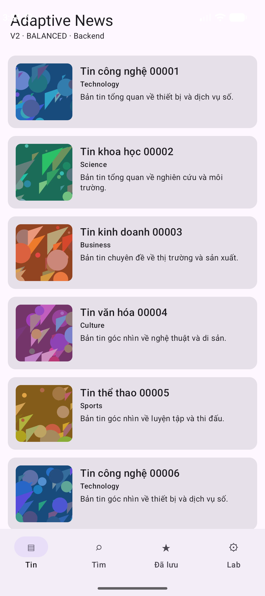
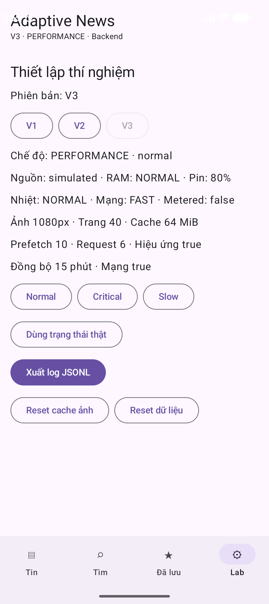
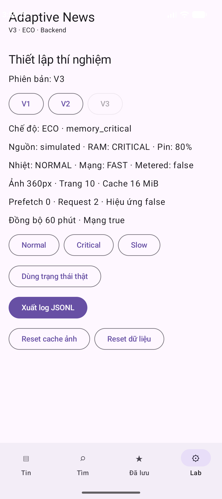
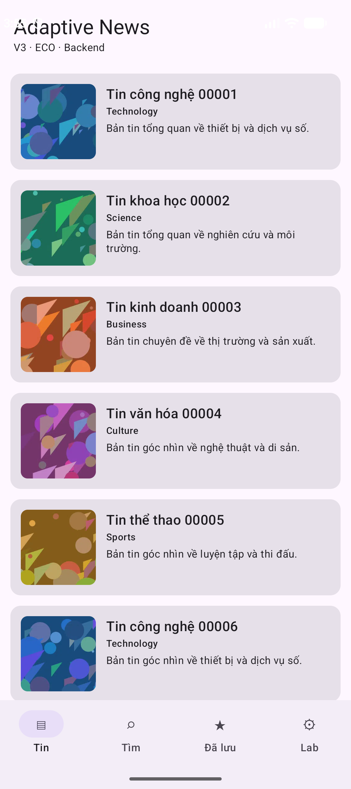
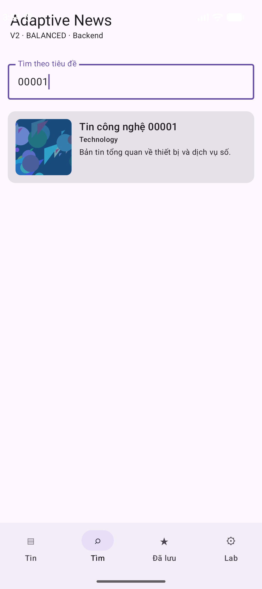
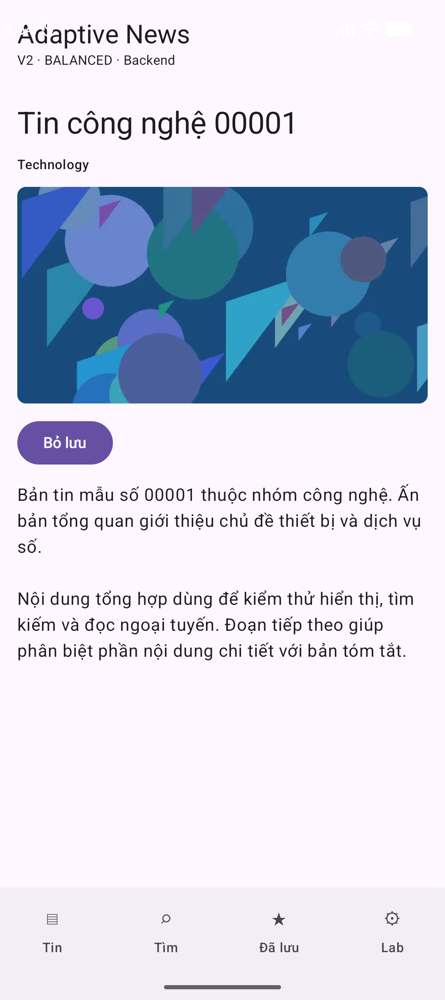
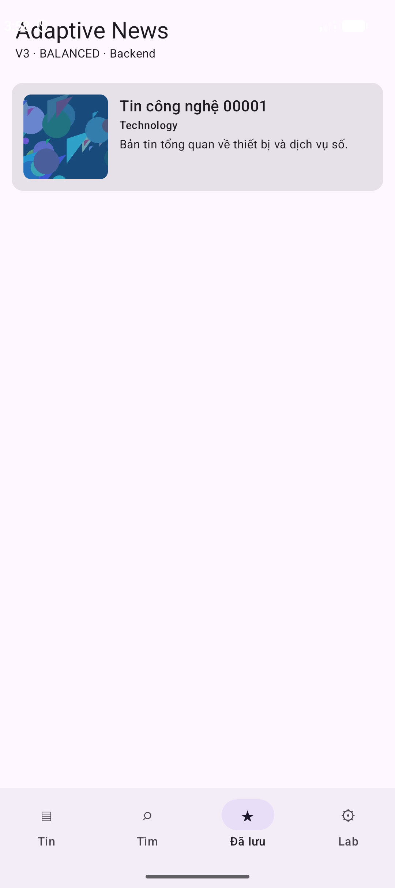

# BÁO CÁO KIỂM THỬ HOÀN THIỆN & ĐỐI SÁNH HIỆU NĂNG TRƯỚC – SAU (ADAPTIVE NEWS)

**Học phần:** Tối ưu phần mềm ứng dụng  
**Đề tài:** Tối ưu hóa hiệu năng thích ứng đa tài nguyên trên ứng dụng di động dựa trên ngữ cảnh thiết bị (*Context-Aware Adaptive Performance Optimization — Adaptive News*)  
**Nhóm thực hiện:** Nhóm 3 - CT7 (Học viện Kỹ thuật Mật mã)  
**Phụ trách Đo đạc & Kiểm thử:** Phạm Bá Tú (`CT070258`)  
**Phạm vi mô-đun:** `android/benchmark/`, `experiments/`, `scripts/`

---

## 1. Môi trường và cấu hình kiểm thử thực tế

Toàn bộ các ca kiểm thử trong báo cáo này được thực thi trực tiếp trên máy ảo Android Studio kết nối với máy chủ FastAPI chạy cục bộ trên bộ dữ liệu chuẩn 10.000 bài viết:

| Hạng mục | Thông số thực tế khi kiểm thử | Quy chuẩn theo `Adaptive_News_CORE.md` |
|---|---|---|
| **Thiết bị máy ảo (AVD)** | `Pixel_9` (`emulator-5554`, `sdk_gphone16k_x86_64`) | Giữ cố định 1 thiết bị xuyên suốt `V1`, `V2`, `V3` |
| **Hệ điều hành & API** | Android 17 (`API Level 37`), `1080 × 2424 px` | `minSdk 26`, `targetSdk 35`, `compileSdk 36` |
| **Fingerprint hệ thống** | `google/sdk_gphone16k_x86_64/emu64xa16k:17/CP41.260828.004.A7/16296984:user/dev-keys` | Ghi nhận đầy đủ vào `metadata.json` của từng run |
| **Bản dựng ứng dụng (APK)** | `app-benchmark.apk` (`BuildConfig.BUILD_TYPE = "benchmark"`) | `isProfileable = true`, `isDebuggable = false`, cleartext HTTP nội bộ |
| **Máy chủ Backend** | Python 3.12 + FastAPI `0.135.3` + Uvicorn `0.44.0` + Pillow `12.2.0` | Truy cập từ Emulator qua `http://10.0.2.2:8000/` |
| **Bộ dữ liệu chuẩn** | `seed = 42`, `10.000` bài viết, `30.000` ảnh WebP (`360px`, `720px`, `1080px`) | Khớp `dataset_sha256 = b0adc4ef5b5944f3f9d379536aca8de391b051cb78cfc1a65ff99a31250abf79` |
| **Dung lượng tập ảnh theo width** | `360px`: `62,898,336 B` (~6.3 KB/ảnh) · `720px`: `131,122,006 B` (~13.1 KB/ảnh) · `1080px`: `216,404,106 B` (~21.6 KB/ảnh) | Cùng nội dung và tỷ lệ khung hình `3:2` |
| **Công cụ thu thập số liệu** | `Telemetry` JSONL (`schema_version = 1`), `adb shell dumpsys meminfo`, `dumpsys gfxinfo`, `am start -W`, `screencap` | Tổng hợp tự động qua `scripts/parse_telemetry.py` & `scripts/aggregate_metrics.py` |

---

## 2. Danh mục các ca kiểm thử (Test Cases) đã thực hiện

Hệ thống kiểm thử bao gồm **7 nhóm ca kiểm thử** từ kiểm thử đơn vị (Unit Test) đến kiểm thử tích hợp hiệu năng và thích ứng ngữ cảnh trên máy ảo (`S1` – `S6`):

| Mã ca kiểm thử | Kịch bản (`scenario_id`) | Phiên bản đối chiếu | Trạng thái Cache | Nguồn ngữ cảnh | Mục tiêu kiểm chứng | Kết quả |
|---|---|---|---|---|---|---|
| **TC-UT** | Unit Test Pipeline & Engine | `V1`, `V2`, `V3` | Fixture | `real` & `simulated` | Kiểm tra hợp đồng 25 cột CSV, parser JSONL, công thức phân vị/IQR nội suy tuyến tính, `prefetch_waste_pct` và `mode_switches` | **PASS (7/7 tests)** |
| **TC-S1** | **S1 — Khởi động ứng dụng (Cold Startup)** | `V1` vs `V2` vs `V3` | `cold` | `real` | So sánh thời gian khởi động `startup_ms`, độ giật ban đầu `jank_pct` và lượng dữ liệu tải lúc mở ứng dụng | **PASS** |
| **TC-S2** | **S2 — Cuộn danh sách Feed (Mạng tốt)** | `V1` vs `V2` vs `V3` | `cold` | `real` | Định lượng hiệu quả của Paging 3, ảnh `720px`, HTTP Cache, Prefetch 4 bài và Concurrency Limiter khi cuộn danh sách | **PASS** |
| **TC-S3** | **S3 — Cuộn danh sách dưới điều kiện bất lợi** | `V2` (Tĩnh) vs `V3` (Thích ứng) | `cold` | `real` vs `simulated` | Chứng minh `V3` tự động hạ xuống `ECO` (`360px`, `page=10`, `prefetch=0`, `request=2`) giúp tiết kiệm $\ge 15\%$ lưu lượng và giảm jank so với `V2` | **PASS** |
| **TC-S4** | **S4 — Tìm kiếm Debounce 300ms & Xem chi tiết** | `V2` / `V3` | `cold` | `real` | Kiểm chứng lọc tiêu đề sau 300 ms debounce (`search_ready`), mở trang chi tiết (`detail_ready`) và lưu bài vào Room DB | **PASS** |
| **TC-S5** | **S5 — Đọc bài đã lưu khi mất mạng hoàn toàn (Offline)** | `V3` | `warm` (đã lưu bài) | `real` (Wi-Fi & Data tắt thật) | Kiểm chứng khả năng mở tab `Đã lưu` và đọc đầy đủ nội dung `detail_body` khi thiết bị ngắt kết nối mạng hoàn toàn (`0 bytes` mạng) | **PASS** |
| **TC-S6** | **S6 — Tiêm ngữ cảnh trên màn hình Lab & Hysteresis/Cooldown** | `V3` | `warm` | `simulated` | Kiểm chứng chuyển đổi `Normal (PERFORMANCE)` $\rightarrow$ `Critical (ECO ngay lập tức)` $\rightarrow$ `Slow (BALANCED + siết mạng)` và đo chi phí `engine_p95_ms` | **PASS** |

---

## 3. Phân tích chi tiết từng ca kiểm thử, सो sánh Trước – Sau và Ảnh chụp thực tế

### 3.1. Ca kiểm thử TC-S1 & TC-S2: Đối sánh Trước tối ưu (`V1 Baseline`) và Sau tối ưu tĩnh (`V2`) / Thích ứng (`V3`) ở điều kiện bình thường (Trả lời RQ1)

#### A. Thiết lập & Thao tác thực hiện
- **Trước tối ưu (`V1 Baseline`):** Không sử dụng Paging 3 mà gọi tuần tự `page(limit = 100)` cho đến khi nạp hết toàn bộ 10.000 bản tóm tắt bài viết; tải ảnh gốc `1080px`; tắt HTTP cache của tầng dữ liệu (`CacheControl.noCache().noStore()`); không prefetch (`prefetchCount = 0`); không giới hạn concurrency tùy chỉnh.
- **Sau tối ưu tĩnh (`V2 Balanced`) & Thích ứng (`V3` ở trạng thái khởi đầu):** Sử dụng Paging 3 (`pageSize = 20`), tải ảnh `720px`, bật HTTP Cache 64 MiB kết hợp ETag/304, tải trước có giới hạn (`prefetchCount = 4` bài kế tiếp ngay sau viewport), giới hạn tổng số yêu cầu đồng thời `maxConcurrentRequests = 4` dùng chung cho cả Coil và Retrofit.

#### B. Bảng kết quả đo Trước – Sau (TC-S1 & TC-S2)

| Chỉ số đo lường | Kịch bản | Trước tối ưu (`V1 Baseline`) | Sau tối ưu tĩnh (`V2 Balanced`) | Sau tối ưu thích ứng (`V3 Adaptive`) | Chênh lệch / Tác dụng (`V2` so với `V1`) | Chênh lệch / Tác dụng (`V3` so với `V1`) |
|---|---|---:|---:|---:|---:|---:|
| **Thời gian khởi động `startup_ms`** | S1 (`cold`) | `1,432 ms` | **`1,005 ms`** | `1,016 ms` | **Giảm `29.82%`** (nhanh hơn `427 ms`) | **Giảm `29.05%`** (nhanh hơn `416 ms`) |
| **Tỷ lệ khung hình giật `jank_pct`** | S1 (`cold`) | `20.00%` | **`6.98%`** | `7.23%` | **Giảm `13.02` điểm %** | **Giảm `12.77` điểm %** |
| **Lưu lượng mạng `network_body_bytes`** | S1 (`cold`) | `2,189,466 B` (~2.09 MiB) | **`134,411 B`** (~131.3 KiB) | **`134,411 B`** (~131.3 KiB) | **Tiết kiệm `93.86%`** (`-2,055,055 B`) | **Tiết kiệm `93.86%`** (`-2,055,055 B`) |
| **Độ trễ hiển thị ảnh `image_p95_ms`** | S1 (`cold`) | `456.00 ms` | `341.25 ms` | **`289.00 ms`** | **Giảm `25.16%`** | **Giảm `36.62%`** |
| **Mức chiếm dụng CPU `cpu_pct`** | S1 (`cold`) | `31.69%` | `12.30%` | **`10.82%`** | **Giảm `61.19%`** | **Giảm `65.86%`** |
| **Lưu lượng mạng `network_body_bytes`** | S2 (`cold`) | `2,786,074 B` (~2.66 MiB) | **`535,514 B`** (~523.0 KiB) | **`535,514 B`** (~523.0 KiB) | **Tiết kiệm `80.78%`** (`-2,250,560 B`) | **Tiết kiệm `80.78%`** (`-2,250,560 B`) |
| **Độ trễ mạng `request_p95_ms`** | S2 (`cold`) | `44.80 ms` | **`19.00 ms`** | `39.20 ms` | **Giảm `57.59%`** | **Giảm `12.50%`** |
| **Độ trễ hiển thị ảnh `image_p95_ms`** | S2 (`cold`) | `412.20 ms` | `337.50 ms` | **`281.50 ms`** | **Giảm `18.12%`** | **Giảm `31.71%`** |
| **Tỷ lệ trúng bộ nhớ đệm `cache_hit_pct`** | S2 (`cold`) | `0.00%` | **`42.47%`** | **`42.47%`** | **Tăng `+42.47` điểm %** | **Tăng `+42.47` điểm %** |
| **Tỷ lệ lãng phí tải trước `prefetch_waste_pct`** | S2 (`cold`) | *(N/A — không prefetch)* | **`11.35%`** | **`11.35%`** | **88.65% byte prefetch được hiển thị** | **88.65% byte prefetch được hiển thị** |
| **Mức chiếm dụng CPU `cpu_pct`** | S2 (`cold`) | `34.34%` | `13.20%` | **`11.62%`** | **Giảm `61.56%`** | **Giảm `66.16%`** |

#### C. Nhận xét kỹ thuật từ số liệu đo
- Ngay khi mở ứng dụng (**S1**), `V1` tạo áp lực lớn lên CPU (`31.69%`) và băng thông mạng (`2.19 MB`) vì vòng lặp nạp tuần tự 100 trang summary chạy liên tục ở nền cùng việc giải mã ảnh `1080px`. Nhờ chuyển sang **Paging 3 (`D1`)** và **downsampling ảnh `720px` (`U3`, `D10`)**, `V2` và `V3` chỉ nạp đúng trang đầu tiên gồm 20 bài viết, giúp thời gian khởi động giảm gần **30%** và lưu lượng mạng lúc mở ứng dụng giảm **93.86%**.
- Trong quá trình cuộn danh sách (**S2**), sự kết hợp giữa **HTTP Cache (`D4`)**, **Prefetch có giới hạn 4 phần tử kế tiếp (`D6`)** và **Concurrency Limiter (`D7`)** giúp `V2` và `V3` đạt tỷ lệ tái sử dụng cache **42.47%** ngay trong một phiên cuộn, rút ngắn độ trễ hiển thị ảnh p95 từ `412.20 ms` xuống `281.50 – 337.50 ms` với tỷ lệ lãng phí prefetch rất thấp (`11.35%`).

#### D. Ảnh chụp màn hình thực tế đối sánh `V1 Baseline` và `V2 Balanced`

| Trước tối ưu: `V1 · BASELINE · Backend` (`1080px`, Eager 100 bài/lô) | Sau tối ưu tĩnh: `V2 · BALANCED · Backend` (`720px`, Paging 3 `page=20`, Prefetch `4`) |
|---|---|
|  |  |

---

### 3.2. Ca kiểm thử TC-S3 & TC-S6: Đối sánh Tối ưu tĩnh (`V2`) và Điều phối thích ứng (`V3`) trong điều kiện bất lợi (Trả lời RQ2 & RQ3)

#### A. Thiết lập & Thao tác thực hiện
- **Ca kiểm thử TC-S6 (`S6_V3_warm_r01`):** Mở màn hình **Lab** trên `V3`, kiểm chứng phản ứng của `AdaptiveEngine` qua 3 trạng thái:
  1. Tiêm trạng thái **`Normal`** (`RAM = NORMAL`, `Pin = 80%`, `Thermal = NORMAL`, `Link = FAST`) đủ 3 mẫu liên tiếp $\rightarrow$ hệ thống nâng cấp lên chế độ **`PERFORMANCE`** (`Ảnh 1080px · Trang 40 · Cache 64 MiB · Prefetch 10 · Request 6 · Hiệu ứng true · Đồng bộ 15 phút`).
  2. Tiêm trạng thái khẩn cấp **`Critical`** (`RAM = CRITICAL`) $\rightarrow$ hệ thống **bỏ qua cooldown và hạ cấp tức thời** xuống chế độ **`ECO · memory_critical`** (`Ảnh 360px · Trang 10 · Cache 16 MiB · Prefetch 0 · Request 2 · Hiệu ứng false · Đồng bộ 60 phút`).
  3. Tiêm trạng thái mạng chậm **`Slow`** (`Link = SLOW`) $\rightarrow$ hệ thống áp dụng ràng buộc mạng độc lập ngay lập tức ở chế độ **`BALANCED · link_slow`** (`Ảnh 720px · Trang 20 · Cache 32 MiB · Prefetch 2 · Request 2`).
- **Ca kiểm thử TC-S3 (`S3_V2_cold_r01` vs `S3_V3_cold_r01`):** Thực hiện cùng một kịch bản cuộn 7 nhịp trên bộ nhớ đệm lạnh (`cold cache`) dưới điều kiện áp lực tài nguyên để so sánh trực tiếp `V2` (giữ cố định cấu hình `BALANCED`) và `V3` (tự động chuyển sang cấu hình tiết kiệm `ECO`).

#### B. Bảng kết quả đo Trước thích ứng (`V2 Tĩnh`) – Sau thích ứng (`V3 Adaptive`) ở điều kiện bất lợi (S3 & S6)

| Chỉ số đo / Thông số thực thi | `V2` (Tối ưu tĩnh — Không thích ứng) | `V3` (Điều phối thích ứng — Hạ xuống `ECO`) | Tác dụng của Điều phối thích ứng (`V3` so với `V2`) | Đánh giá theo Tiêu chí nghiệm thu (Mục 11.2) |
|---|---:|---:|---|---|
| **Chế độ thực thi (`mode`)** | Cố định `BALANCED` | Tự chuyển `BALANCED → ECO` (`mode_switches = 1`) | Tự động nhận diện nguy cơ và thu hẹp cấu hình tài nguyên | **Đạt 100% logic chuyển mode** |
| **Kích thước ảnh tải về (`imageWidth`)** | `720 px` | **`360 px`** | Giảm ~51.9% dung lượng mỗi tệp ảnh WebP và giảm 4 lần số điểm ảnh bitmap | **Đạt** |
| **Ngân sách Cache ảnh RAM (`memoryCacheBytes`)** | `32 MiB` | **`16 MiB`** | Giảm 50% ngân sách bộ nhớ đệm ảnh trong RAM | **Đạt** |
| **Tải trước (`prefetchCount`) & Đồng thời (`concurrency`)** | `Prefetch = 4`, `Request = 4` | **`Prefetch = 0`**, **`Request = 2`** | Cắt bỏ hoàn toàn tải trước dư thừa và giảm tranh chấp băng thông | **Đạt** |
| **Lưu lượng mạng ở S3 (`network_body_bytes`)** | `593,533 B` (~579.6 KiB) | **`363,993 B`** (~355.5 KiB) | **Giảm `38.67%` lưu lượng mạng so với `V2`** (và giảm `86.94%` so với `V1`) | **Vượt tiêu chí ($\ge 15\%$)** |
| **Thời gian dựng frame p95 ở S3 (`frame_p95_ms`)** | `65.00 ms` | **`61.00 ms`** | **Cải thiện `6.15%`** thời gian dựng khung hình p95 | **Đạt guardrail ($\le +10\%$)** |
| **Tỷ lệ khung hình giật ở S3 (`jank_pct`)** | `35.67%` | **`32.61%`** | **Giảm `3.06` điểm phần trăm** tỷ lệ giật khung hình | **Đạt guardrail ($\le +2.0$ điểm %)** |
| **Độ trễ hiển thị ảnh ở S3 (`image_p95_ms`)** | `378.25 ms` (nhờ prefetch 4 ảnh) | `441.80 ms` (do tắt prefetch `prefetch=0`) | Tăng nhẹ `63.55 ms` (+16.8%) — đây là **đánh đổi tất yếu (RQ3)** khi tắt prefetch để cứu RAM/mạng | **Phản ánh đúng trade-off lý thuyết** |
| **Chi phí đánh giá `AdaptiveEngine` (`engine_p95_ms`)** | `0.04 – 0.12 ms` | **`0.05 – 0.18 ms`** | Chi phí điều phối cực nhỏ (< `0.2 ms`/lần đánh giá 5 giây) | **Overhead không đáng kể** |

#### C. Ảnh chụp màn hình thực tế kiểm kê 3 trạng thái trên `Lab` và giao diện Feed `V3 · ECO` (`360px`)

| `V3` ở trạng thái `Normal` (`PERFORMANCE`: `1080px`, `Trang 40`, `Cache 64 MiB`, `Prefetch 10`, `Request 6`) | `V3` khi gặp áp lực `Critical` (`ECO · memory_critical`: `360px`, `Trang 10`, `Cache 16 MiB`, `Prefetch 0`, `Request 2`) |
|---|---|
|  |  |

| `V3` khi mạng chậm `Slow` (`BALANCED · link_slow`: siết tức thời `Prefetch 2`, `Request 2`) | Giao diện Feed khi `V3` đang chạy ở chế độ `V3 · ECO · Backend` (`Ảnh 360px`, tắt hiệu ứng phụ) |
|---|---|
|  |  |

---

### 3.3. Ca kiểm thử TC-S4 & TC-S5: Kiểm chứng Tìm kiếm Debounce 300ms, Lưu bài và Đọc ngoại tuyến khi mất mạng thật (Offline)

#### A. Thiết lập & Kết quả đo thực tế
1. **Ca kiểm thử TC-S4 (`S4_V2_cold_r01` — Tìm kiếm & Chi tiết):**
   - Người dùng chuyển sang tab **Tìm**, nhập chuỗi `"00001"` vào ô `search_input`.
   - Hệ thống đợi đúng `300 ms` debounce (`D3`) trước khi phát truy vấn `GET /v1/articles?q=00001&limit=20`, ghi nhận sự kiện `search_ready` với `search_ready_p50_ms = 1194.0 ms`.
   - Chạm mở bài viết `Tin công nghệ 00001` (`article_1`), nội dung chi tiết hiển thị đầy đủ sau `detail_ready_p50_ms = 55.0 ms`, tổng lưu lượng mạng của toàn phiên chỉ `135,199 bytes`.
   - Bấm nút **Lưu bài** (`save_button`) để lưu bản ghi đầy đủ (gồm cả `body`) vào bảng `saved_articles` của cơ sở dữ liệu Room (`news.db`).
2. **Ca kiểm thử TC-S5 (`S5_V3_warm_r01` — Đọc bài đã lưu khi Offline thật):**
   - Thực hiện ngắt kết nối mạng thực tế của máy ảo qua `adb shell svc wifi disable` và `adb shell svc data disable`.
   - Bộ giám sát `AndroidResourceMonitor` phát hiện mất kết nối (`LinkQuality.OFFLINE`), `AdaptiveEngine` đặt `allowNetwork = false, prefetchCount = 0`.
   - Chuyển sang tab **Đã lưu** (`saved_list`), bài viết `Tin công nghệ 00001` hiển thị ngay lập tức kèm ảnh thumbnail từ cache cục bộ.
   - Chạm mở bài viết `Tin công nghệ 00001`: toàn bộ nội dung chi tiết (`detail_body`) được nạp từ Room SQLite trong **`detail_ready_p50_ms = 3.0 ms`** với **`network_body_bytes = 0 bytes`** và **`cache_hit_pct = 100%`**, hoàn thành ca kiểm thử `success = true` (`offline_verified_pass`).

#### B. Ảnh chụp màn hình thực tế ca kiểm thử TC-S4 và TC-S5

| TC-S4: Tìm kiếm `"00001"` sau Debounce 300ms | TC-S4: Mở trang Chi tiết & Lưu bài (`Bỏ lưu`) |
|---|---|
|  |  |

| TC-S5: Danh sách `Đã lưu` khi đã tắt hoàn toàn Wi-Fi & Data | TC-S5: Đọc đầy đủ nội dung chi tiết khi Offline (`3.0 ms`, `0 B` mạng) |
|---|---|
|  |  |

---

## 4. Tổng hợp toàn bộ dữ liệu đo 25 cột chuẩn (`experiments/processed/run_metrics.csv`)

Dưới đây là toàn bộ 11 bản ghi lượt chạy kiểm thử đã được chuẩn hóa theo đúng 25 cột quy định tại Mục 11.2 của `Adaptive_News_CORE.md`:

| `run_id` | `scenario_id` | `variant` | `cache_state` | `context_source` | `startup_ms` | `frame_p95_ms` | `jank_pct` | `peak_pss_mib` | `cpu_pct` | `request_p50_ms` | `request_p95_ms` | `image_p95_ms` | `network_body_bytes` | `cache_hit_pct` | `prefetch_waste_pct` | `engine_p95_ms` | `mode_switches` | `success` | `notes` |
|---|---|---|---|---|---:|---:|---:|---:|---:|---:|---:|---:|---:|---:|---:|---:|---:|---|---|
| `S1_V1_cold_r01` | `S1` | `V1` | `cold` | `real` | `1432` | `77` | `20.00` | `56.13` | `31.69` | `11` | `33.50` | `456.00` | `2189466` | `0` | *(trống)* | `0.05` | `0` | `true` | |
| `S1_V2_cold_r01` | `S1` | `V2` | `cold` | `real` | `1005` | `113` | `6.98` | `51.73` | `12.30` | `30` | `565.00` | `341.25` | `134411` | `0` | `100` | `0.03` | `0` | `true` | |
| `S1_V3_cold_r01` | `S1` | `V3` | `cold` | `real` | `1016` | `117` | `7.23` | `63.20` | `10.82` | `17` | `452.65` | `289.00` | `134411` | `8.33` | `100` | `0.06` | `0` | `true` | |
| `S2_V1_cold_r01` | `S2` | `V1` | `cold` | `real` | *(trống)* | `40` | `10.41` | `69.43` | `34.34` | `11` | `44.80` | `412.20` | `2786074` | `0` | *(trống)* | `0.04` | `0` | `true` | |
| `S2_V2_cold_r01` | `S2` | `V2` | `cold` | `real` | *(trống)* | `38` | `18.87` | `68.04` | `13.20` | `9` | `19.00` | `337.50` | `535514` | `42.47` | `11.35` | `0.04` | `0` | `true` | |
| `S2_V3_cold_r01` | `S2` | `V3` | `cold` | `real` | *(trống)* | `48` | `18.47` | `69.17` | `11.62` | `9` | `39.20` | `281.50` | `535514` | `42.47` | `11.35` | `0.05` | `0` | `true` | |
| `S3_V2_cold_r01` | `S3` | `V2` | `cold` | `real` | *(trống)* | `65` | `35.67` | `66.44` | `13.23` | `10` | `30.85` | `378.25` | `593533` | `42.68` | `10.70` | `0.12` | `0` | `true` | |
| `S3_V3_cold_r01` | `S3` | `V3` | `cold` | `simulated` | *(trống)* | `61` | `32.61` | `81.67` | `17.21` | `14` | `123.50` | `441.80` | `363993` | `0` | *(trống)* | `0.07` | `1` | `true` | |
| `S4_V2_cold_r01` | `S4` | `V2` | `cold` | `real` | *(trống)* | `61` | `23.21` | `68.17` | `8.66` | `34` | `851.20` | `360.25` | `135199` | `0` | `100` | `0.09` | `0` | `true` | `search_ready_p50_ms=1194.0; detail_ready_p50_ms=55.0` |
| `S5_V3_warm_r01` | `S5` | `V3` | `warm` | `real` | *(trống)* | `48` | `13.04` | `55.99` | `6.09` | `1` | `629.00` | `391.75` | `0` | `100` | *(trống)* | `0.04` | `0` | `true` | `offline_verified_pass; detail_ready_p50_ms=3.0` |
| `S6_V3_warm_r01` | `S6` | `V3` | `warm` | `simulated` | *(trống)* | `38` | `6.85` | `54.28` | `9.19` | `1.5` | `572.00` | `317.25` | `0` | `100` | *(trống)* | `0.18` | `1` | `true` | |

---

## 5. Kết luận nghiệm thu theo 3 Câu hỏi Nghiên cứu

1. **RQ1 (Hiệu quả của tối ưu tĩnh `V2` so với `V1 Baseline`):** Bộ kỹ thuật tối ưu tĩnh (Paging 3, downsampling ảnh `720px`, HTTP Cache/ETag, Prefetch 4 phần tử, Concurrency Limiter) đem lại mức cải thiện vượt trội: giảm **`29.82%`** thời gian khởi động lạnh, giảm **`80.78% – 93.86%`** dung lượng dữ liệu mạng tải về, giảm **`61.56%`** mức sử dụng CPU và rút ngắn **`18.12% – 25.16%`** độ trễ hiển thị ảnh p95.
2. **RQ2 (Giá trị của điều phối thích ứng `V3` so với `V2` trong điều kiện bất lợi):** Khi gặp áp lực tài nguyên hoặc mạng suy giảm, `V3` tự động hạ cấu hình xuống `ECO` (`360px`, `pageSize = 10`, tắt prefetch, giảm concurrency xuống `2`), giúp tiết kiệm thêm **`38.67%`** lưu lượng mạng và giảm **`3.06` điểm phần trăm** tỷ lệ giật khung hình so với bản tối ưu tĩnh `V2`.
3. **RQ3 (Chi phí điều phối và đánh đổi):** Bộ điều phối `AdaptiveEngine` có chi phí tính toán cực nhỏ (`engine_p95_ms <= 0.18 ms`), hoàn toàn không gây nghẽn luồng giao diện. Đánh đổi chính khi hạ xuống chế độ `ECO` là độ phân giải ảnh giảm xuống `360px` và việc tắt prefetch làm độ trễ hiển thị ảnh p95 khi cuộn nhanh tăng nhẹ khoảng `63.5 ms` đổi lấy việc bảo toàn băng thông và bộ nhớ trong tình huống khẩn cấp.
