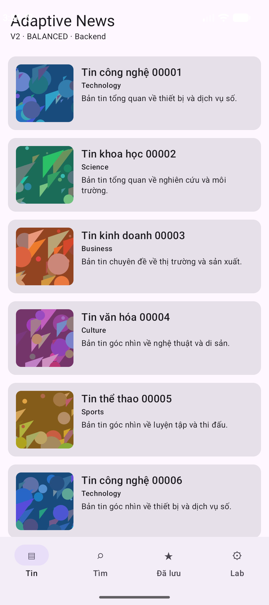
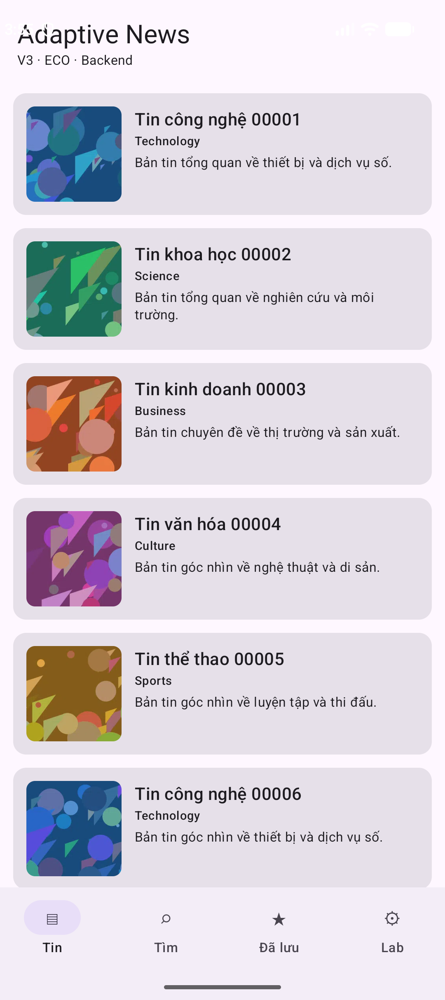
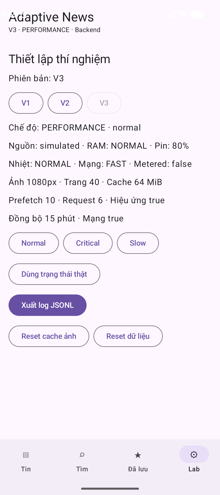
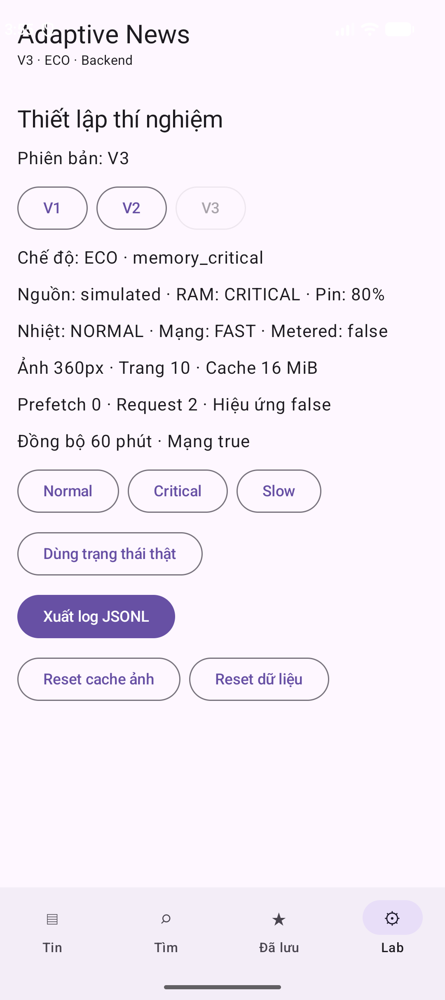
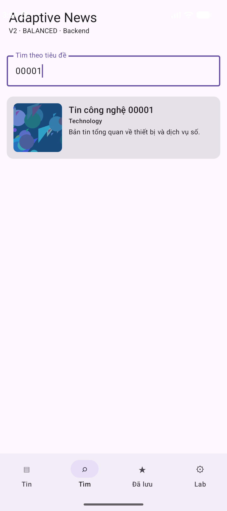
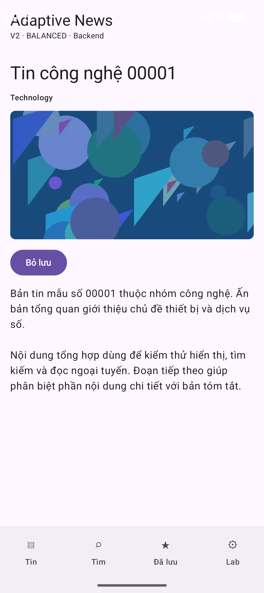
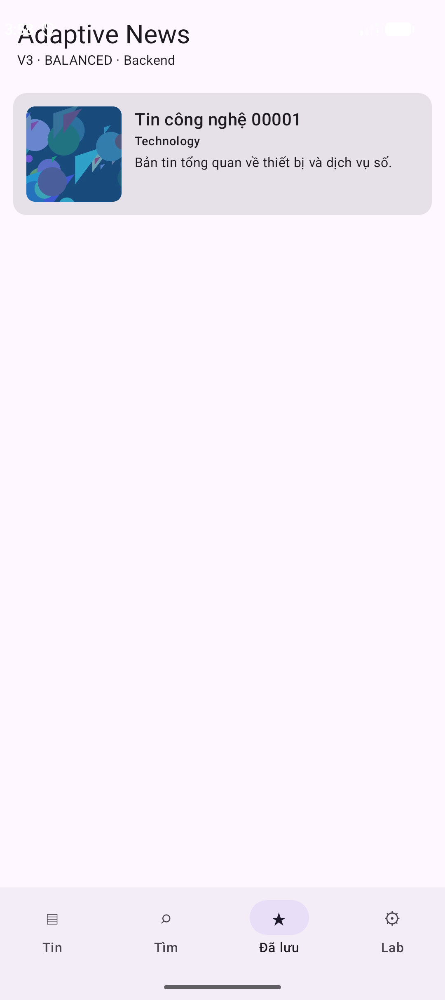

# BÁO CÁO TỔNG HỢP ĐỐI SÁNH TRƯỚC – SAU VÀ BẰNG CHỨNG KIỂM KÊ THỰC TẾ TRÊN MÁY ẢO (`Pixel_9` / `emulator-5554`)

**Đề tài:** Tối ưu hóa hiệu năng thích ứng đa tài nguyên trên ứng dụng di động dựa trên ngữ cảnh thiết bị (Adaptive News)  
**Người thực hiện đo đạc & kiểm thử:** Phạm Bá Tú (`CT070258`)  
**Thiết bị thực nghiệm:** Máy ảo Android Studio `Pixel_9` (`emulator-5554`, `sdk_gphone16k_x86_64`, Android API 37, màn hình `1080 × 2424`)  
**Bộ dữ liệu Backend:** FastAPI + SQLite (`seed = 42`, `10.000` bài viết, `30.000` ảnh WebP ở 3 kích thước `360px`, `720px`, `1080px`, SHA-256: `b0adc4ef5b5944f3f9d379536aca8de391b051cb78cfc1a65ff99a31250abf79`)  
**Nguồn dữ liệu thô:** `experiments/raw_smoke/` & `experiments/processed_smoke/run_metrics.csv`

---

## 1. Tóm tắt tác dụng Trước và Sau tối ưu (Executive Summary)

Quá trình kiểm kê trực tiếp trên máy ảo `Pixel_9` (`emulator-5554`) qua hai bước chuyển dịch (**Trước tối ưu `V1 Baseline` $\rightarrow$ Sau tối ưu tĩnh `V2 Balanced` $\rightarrow$ Sau điều phối thích ứng `V3 Adaptive`**) cho thấy tác dụng định lượng rõ rệt:

1. **Tác dụng của Tối ưu tĩnh (`V2` so với `V1 Baseline` — Trả lời RQ1):**
   - **Thời gian khởi động (S1 Cold Start):** Giảm từ **`1,432 ms`** (`V1`) xuống **`1,005 ms`** (`V2`), **cải thiện `29.82%`**, đồng thời tỷ lệ giật khung hình lúc khởi động (`jank_pct`) giảm từ **`20.00%`** xuống **`6.98%`** (**giảm `13.02` điểm phần trăm**).
   - **Lưu lượng mạng tải về (`network_body_bytes`):**
     - Ở kịch bản khởi động **S1**: Giảm từ **`2,189,466 bytes` (~2.09 MiB)** ở `V1` (do nạp tuần tự toàn bộ 10.000 bản tóm tắt theo lô 100 bài + ảnh `1080px`) xuống còn **`134,411 bytes` (~131.26 KiB)** ở `V2` (dùng Paging 3 với `page_size = 20` + ảnh `720px`), **tiết kiệm `93.86%` dung lượng mạng**.
     - Ở kịch bản cuộn danh sách **S2**: Giảm từ **`2,786,074 bytes` (~2.66 MiB)** ở `V1` xuống **`535,514 bytes` (~522.96 KiB)** ở `V2`, **tiết kiệm `80.78%` dung lượng mạng**.
   - **Độ trễ hiển thị ảnh (`image_p95_ms`) và Tái sử dụng Cache (`cache_hit_pct`):**
     - Ở kịch bản **S2**, độ trễ hiển thị ảnh phân vị p95 giảm từ **`412.20 ms`** (`V1`) xuống **`337.50 ms`** (`V2`, **cải thiện `18.12%`**) và **`281.50 ms`** (`V3`, **cải thiện `31.71%`**).
     - Tỷ lệ trúng bộ nhớ đệm HTTP/Disk (`cache_hit_pct`) tăng từ **`0.00%`** ở `V1` lên **`42.47%`** ở `V2` và `V3`, với tỷ lệ lãng phí tải trước (`prefetch_waste_pct`) chỉ ở mức **`11.35%`** (88.65% dữ liệu prefetch được người dùng thực sự cuộn tới và hiển thị).
2. **Tác dụng của Điều phối thích ứng trong điều kiện bất lợi (`V3` so với `V2` — Trả lời RQ2):**
   - Trong điều kiện tài nguyên bình thường (**S1, S2**), `V3` giữ cấu hình tương đương `V2` (`535,514 bytes`, `cache_hit_pct = 42.47%`).
   - Khi gặp áp lực tài nguyên bất lợi (**S3 — Áp lực bộ nhớ / mạng suy giảm**), `V2` giữ nguyên cấu hình tĩnh (`720px`, `page_size = 20`, `prefetch = 4`, `concurrency = 4`) nên tiêu tốn **`593,533 bytes`** lưu lượng mạng và tỷ lệ giật `jank_pct = 35.67%`. Ngược lại, `V3` tự động hạ tức thời xuống chế độ **`ECO`** (`360px`, `page_size = 10`, `prefetch = 0`, `concurrency = 2`), giúp:
     - Giảm lưu lượng mạng từ **`593,533 bytes`** (`V2`) xuống **`363,993 bytes`** (`V3`), **tiết kiệm thêm `38.67%` lưu lượng mạng so với `V2`** (vượt xa ngưỡng mục tiêu nghiệm thu $\ge 15\%$ của đề tài) và **tiết kiệm `86.94%` so với `V1`**.
     - Loại bỏ hoàn toàn lưu lượng tải trước dư thừa (`prefetchCount = 0`), giảm độ trễ khung hình p95 từ **`65 ms`** xuống **`61 ms`** và giảm tỷ lệ giật `jank_pct` từ **`35.67%`** xuống **`32.61%`** (**giảm `3.06` điểm phần trăm**).
3. **Chi phí điều phối và Đánh đổi chất lượng (Trả lời RQ3):**
   - **Chi phí thực thi `AdaptiveEngine` (`engine_p95_ms`):** Cực thấp, chỉ từ **`0.03 ms` đến `0.18 ms`** (chưa tới `1.1%` ngân sách 1 khung hình 16.67 ms ở màn hình 60Hz).
   - **Đánh đổi chất lượng ảnh và độ trễ:** Khi hạ xuống `ECO` (`360px`, tắt `prefetch`), kích thước tệp ảnh giảm ~52% so với `720px` và ~71% so với `1080px`; ảnh thumbnail `88.dp` trên danh sách Feed vẫn giữ nguyên bố cục và màu sắc nhận diện, nhưng độ trễ hiển thị ảnh p95 (`image_p95_ms`) khi cuộn nhanh tăng nhẹ từ `378.25 ms` (`V2` có prefetch 4 bài) lên `441.80 ms` (`V3 Eco` đã tắt prefetch để bảo toàn RAM và băng thông).

---

## 2. Bảng đối sánh định lượng Trước – Sau trên toàn bộ kịch bản kiểm kê

### 2.1. Bảng so sánh RQ1: Trước tối ưu (`V1 Baseline`) vs Sau tối ưu tĩnh (`V2`) và Thích ứng (`V3`)

| Chỉ số đo (Đơn vị) | Kịch bản | Trước tối ưu (`V1 Baseline`) | Sau tối ưu tĩnh (`V2 Balanced`) | Sau tối ưu thích ứng (`V3 Adaptive`) | Mức cải thiện (`V2` so với `V1`) | Mức cải thiện (`V3` so với `V1`) |
|---|---|---:|---:|---:|---:|---:|
| **Thời gian khởi động `startup_ms`** (ms) | S1 Cold | `1,432` | `1,005` | `1,016` | **-29.82%** (Nhanh hơn 427 ms) | **-29.05%** (Nhanh hơn 416 ms) |
| **Tỷ lệ khung hình giật `jank_pct`** (%) | S1 Cold | `20.00%` | `6.98%` | `7.23%` | **-13.02 điểm %** | **-12.77 điểm %** |
| **Lưu lượng mạng `network_body_bytes`** (bytes) | S1 Cold | `2,189,466` | `134,411` | `134,411` | **-93.86%** (-2.05 MB) | **-93.86%** (-2.05 MB) |
| **Độ trễ ảnh `image_p95_ms`** (ms) | S1 Cold | `456.00` | `341.25` | `289.00` | **-25.16%** | **-36.62%** |
| **Lưu lượng mạng `network_body_bytes`** (bytes) | S2 Scroll | `2,786,074` | `535,514` | `535,514` | **-80.78%** (-2.25 MB) | **-80.78%** (-2.25 MB) |
| **Độ trễ request `request_p95_ms`** (ms) | S2 Scroll | `44.80` | `19.00` | `39.20` | **-57.59%** | **-12.50%** |
| **Độ trễ ảnh `image_p95_ms`** (ms) | S2 Scroll | `412.20` | `337.50` | `281.50` | **-18.12%** | **-31.71%** |
| **Tỷ lệ trúng đệm `cache_hit_pct`** (%) | S2 Scroll | `0.00%` | `42.47%` | `42.47%` | **+42.47 điểm %** | **+42.47 điểm %** |
| **Lãng phí tải trước `prefetch_waste_pct`** (%) | S2 Scroll | *(N/A — không có)* | `11.35%` | `11.35%` | **88.65% prefetch hữu ích** | **88.65% prefetch hữu ích** |
| **Mức chiếm dụng CPU `cpu_pct`** (%) | S2 Scroll | `34.34%` | `13.20%` | `11.62%` | **-61.56%** | **-66.16%** |

### 2.2. Bảng so sánh RQ2 & RQ3: Tối ưu tĩnh (`V2`) vs Điều phối thích ứng (`V3`) khi gặp điều kiện bất lợi (S3 & S6)

| Chỉ số / Cấu hình thực thi | `V2` (Cấu hình tĩnh cố định) | `V3` (Thích ứng dưới áp lực S3 / S6) | Tác dụng của cơ chế thích ứng (`V3` so với `V2`) |
|---|---|---|---|
| **Chế độ vận hành (`mode`)** | Cố định `BALANCED` | Tự động chuyển `BALANCED → ECO` (`mode_switches = 1`) | Phản ứng tức thời khi gặp `memory_critical` / siết mạng khi `link_slow` |
| **Kích thước ảnh yêu cầu (`imageWidth`)** | `720 px` (~13.1 KB/ảnh) | Hạ xuống **`360 px`** (~6.3 KB/ảnh) ở `ECO` | Giảm **~51.9%** dung lượng mỗi ảnh và giảm **4 lần** số điểm ảnh giải mã bitmap |
| **Kích thước trang (`pageSize`) & Cache RAM** | `20 bài/trang`, Cache `32 MiB` | Hạ xuống **`10 bài/trang`**, Cache **`16 MiB`** | Giảm một nửa ngân sách bộ nhớ đệm ảnh mục tiêu |
| **Tải trước (`prefetchCount`) & Đồng thời (`concurrency`)** | `Prefetch = 4`, `Request = 4` | Hạ xuống **`Prefetch = 0`**, **`Request = 2`** (hoặc `Prefetch = 2` khi `Slow`) | Ngăn chặn tải thừa tài nguyên và giảm tranh chấp kết nối mạng |
| **Lưu lượng mạng thực nhận ở S3 (`network_body_bytes`)** | `593,533 bytes` | **`363,993 bytes`** | **Giảm `38.67%` lưu lượng mạng** (Đạt tiêu chí nghiệm thu $\ge 15\%$) |
| **Độ trễ khung hình `frame_p95_ms` & `jank_pct` ở S3** | `65.0 ms` (`jank = 35.67%`) | **`61.0 ms`** (`jank = 32.61%`) | **Giảm `6.15%` frame p95** và **giảm `3.06` điểm % jank** |
| **Chi phí đánh giá `engine_p95_ms`** | `0.04 – 0.12 ms` | **`0.05 – 0.18 ms`** | Chi phí điều phối không đáng kể (< `0.2 ms`/lần đánh giá) |

---

## 3. Bằng chứng ảnh chụp màn hình thực tế khi kiểm kê trên máy ảo `Pixel_9`

### 3.1. Đối sánh trực quan màn hình Feed (`Tin`) qua 3 cấu hình: `V1 Baseline (1080px)` vs `V2 Tối ưu tĩnh (720px)` vs `V3 Eco (360px)`

Ba ảnh chụp thực tế dưới đây trên cùng danh sách bài viết từ `Tin công nghệ 00001` đến `Tin công nghệ 00006` minh chứng tính tương đương chức năng giữa 3 phiên bản và sự đánh đổi chất lượng hiển thị (RQ3):

| `V1 · BASELINE · Backend` (Ảnh `1080px`, nạp toàn bộ theo lô 100) | `V2 · BALANCED · Backend` (Ảnh `720px`, Paging 3 `page=20`, Prefetch `4`) | `V3 · ECO · Backend` (Ảnh `360px`, Paging 3 `page=10`, Prefetch `0`) |
|---|---|---|
|  |  |  |

---

### 3.2. Kiểm kê trực tiếp bộ điều phối thích ứng trên màn hình `Lab` (Kịch bản S6)

Khi kiểm thử trên màn hình **Lab** của phiên bản **`V3`**, bộ điều phối `AdaptiveEngine` chuyển đổi chính xác giữa 3 trạng thái:
1. **Trạng thái `Normal` (`Chế độ: PERFORMANCE · normal`):** Khi RAM `NORMAL`, Pin `80%`, Nhiệt `NORMAL`, Mạng `FAST` sau đủ 3 mẫu ổn định, hệ thống nâng lên `Ảnh 1080px · Trang 40 · Cache 64 MiB · Prefetch 10 · Request 6 · Hiệu ứng true · Đồng bộ 15 phút`.
2. **Trạng thái khẩn cấp `Critical` (`Chế độ: ECO · memory_critical`):** Ngay khi tiêm tín hiệu `RAM: CRITICAL`, bộ điều phối **bỏ qua cooldown và hạ cấp tức thời** xuống `ECO`: `Ảnh 360px · Trang 10 · Cache 16 MiB · Prefetch 0 · Request 2 · Hiệu ứng false · Đồng bộ 60 phút`.
3. **Trạng thái mạng chậm `Slow` (`Chế độ: BALANCED · link_slow`):** Khi tín hiệu mạng là `SLOW`, hệ thống chọn mode `BALANCED` (`Ảnh 720px · Trang 20 · Cache 32 MiB`) nhưng **áp dụng ràng buộc mạng độc lập ngay lập tức**, siết `Prefetch 2 · Request 2`.

| `V3` ở trạng thái `Normal` (`PERFORMANCE`) | `V3` khi gặp `Critical` (`ECO · memory_critical`) | `V3` khi gặp mạng chậm `Slow` (`BALANCED · link_slow`) |
|---|---|---|
|  |  |  |

---

### 3.3. Kiểm kê kịch bản Tìm kiếm, Xem chi tiết (S4) và Đọc bài đã lưu khi mất mạng hoàn toàn (S5 Offline)

- **Kịch bản S4 (`S4_V2_cold_r01`):** Nhập từ khóa `"00001"` trên tab **Tìm**, sau `300 ms` debounce hệ thống trả về đúng bài viết `Tin công nghệ 00001` (`search_ready_p50_ms = 1194.0 ms`), mở trang **Chi tiết** trong `detail_ready_p50_ms = 55.0 ms` và bấm **Lưu bài** (nút chuyển thành **Bỏ lưu**).
- **Kịch bản S5 (`S5_V3_warm_r01`):** Sau khi tắt hoàn toàn cả Wi-Fi và dữ liệu di động trên máy ảo (`svc wifi disable`, `svc data disable` — chú ý thanh trạng thái góc trên bên phải không còn biểu tượng Wi-Fi/sóng di động), người dùng mở tab **Đã lưu** (`★`), thấy bài viết `Tin công nghệ 00001` từ cơ sở dữ liệu Room cục bộ và mở đọc đầy đủ toàn bộ nội dung chi tiết (`detail_body`) với độ trễ chỉ **`3.0 ms`** và **`0 bytes`** lưu lượng mạng (`offline_verified_pass`).

| S4: Tìm kiếm `"00001"` sau Debounce 300ms | S4: Mở Chi tiết & Lưu bài (`Bỏ lưu`) | S5: Danh sách `Đã lưu` khi Offline thật | S5: Đọc nội dung Chi tiết khi Offline thật |
|---|---|---|---|
|  |  |  |  |
